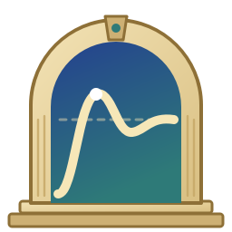
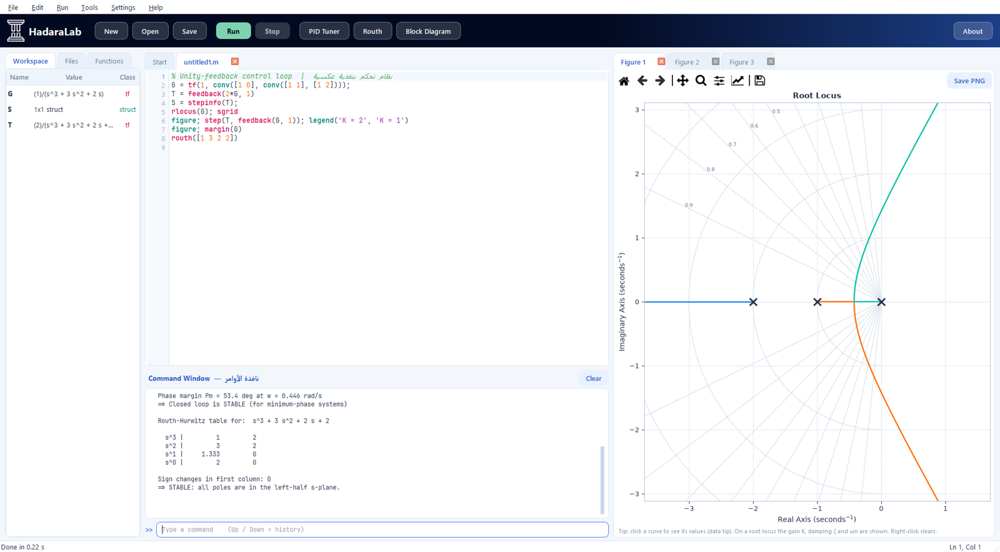
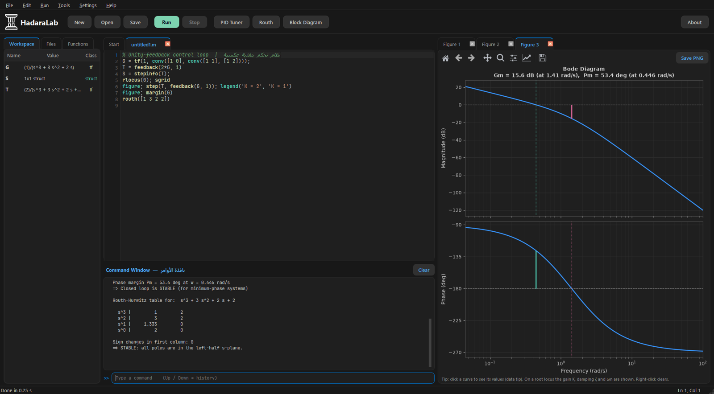

<p align="center">
  
</p>

<h1 align="center">HadaraLab</h1>

<p align="center">
  بيئة برمجية مجانية بصيغة الماتلاب، مخصصة لمادة <b>أسس هندسة السيطرة</b>.
</p>

<p align="center">
  <a href="https://apps.microsoft.com/detail/9NBFTFTG5CRK">
    
  </a>
</p>



## لماذا HadaraLab؟

الماتلاب برنامج ممتاز، لكن رخصته مدفوعة وحجمه كبير، ويحتاج إلى حساب وإنترنت لتفعيله.
وأغلب ما يحتاجه طالب المادة منه محدود: دالة التحويل، والاستجابة الزمنية، وراوث، والمحل الهندسي للجذور، وبود.

يوفّر HadaraLab هذه الأدوات بصيغة الماتلاب نفسها، فالكود الذي تكتبه في المحاضرة يعمل هنا كما هو.
البرنامج مجاني، ويعمل دون إنترنت، ولا يجمع أي بيانات.

## التثبيت

**من متجر Microsoft** (الأسهل، والتحديثات تصل تلقائياً): اضغط زر المتجر في الأعلى.

**دون تثبيت:** نزّل ملف ZIP من [Releases](https://github.com/dvlinuxx-max/HadaraLab/releases)، وفُكّ الضغط، ثم شغّل `HadaraLab.exe`.

**من الكود:**

```bash
pip install -r requirements.txt
python main.py
```

يعمل على Windows 10 و11، وجُرِّب على Python 3.12.

## مثال

```matlab
G = tf(10, [1 3 2]);
T = feedback(G, 1);

step(G, T), grid on
S = stepinfo(T)

routh([1 3 2 10])
rlocus(G), sgrid
margin(G)
```

## المزايا

- محرر بتلوين الكود والإكمال التلقائي، ونافذة أوامر، ومساحة عمل (Workspace)
- أكثر من 260 دالة، منها `tf` و`feedback` و`step` و`stepinfo` و`bode` و`margin` و`nyquist` و`rlocus` و`routh` و`pid` و`ss` و`place` و`lqr`
- أدوات تفاعلية: ضبط متحكم PID، وجدول راوث، والمخطط الصندوقي
- يقبل برامج كتاب Ogata بصيغتها القديمة، مثل `step(num,den)`
- مظهر فاتح ومظهر داكن
- حفظ تلقائي، فإذا انقطعت الكهرباء تُستعاد البرامج غير المحفوظة

اكتب `help` داخل البرنامج لعرض قائمة الدوال كاملة.



## الأمثلة

في المجلد `examples` أربعة عشر مثالاً مرتبة وفق مفردات المادة، وفي `examples/ogata` ستة عشر برنامجاً
من كتاب *Ogata, Modern Control Engineering*.

## الاختبارات

```bash
python tests/test_engine.py
```

## الفريق

- **محمد عبدالرحمن محمود**: البرمجة ([@devlopxx](https://www.instagram.com/devlopxx/))
- **أحمد البصري**: الأيقونة والهوية البصرية ([@dcssi_](https://www.instagram.com/dcssi_/))

للتواصل: support@mohmadev.com — [mohmadev.com](https://mohmadev.com/)

## الرخصة

الكود مرخّص برخصة [MIT](LICENSE). أما الأيقونة والشعار فمن تصميم أحمد البصري، ولا تشملهما الرخصة.
سياسة الخصوصية في الملف [PRIVACY.md](PRIVACY.md).
